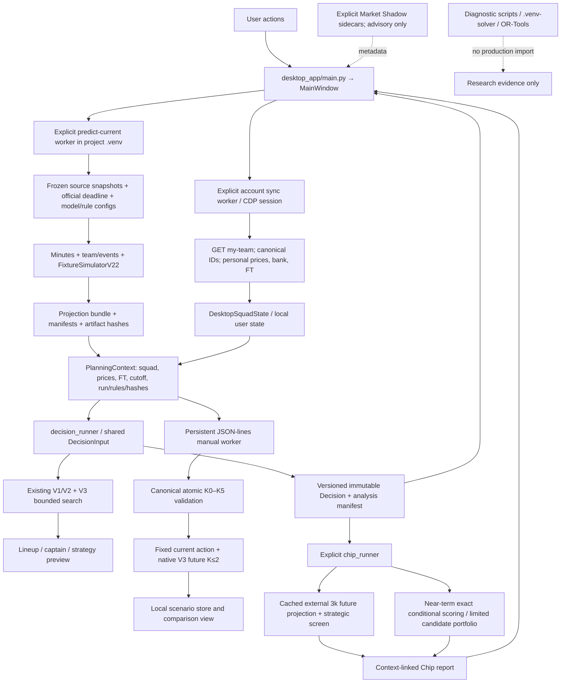

# FPL Control Center — independent engine and application audit

Audit date: **23 October 2026**. Scope: current, already dirty working tree in `Fantasy-PL`, including the released Manual Transfer Comparator. This is an engineering audit, not a release or an implementation. Findings apply to the inspected source/artifact identities, not every historical version.

## A. Executive summary

**Overall health:** useful, carefully constrained personal decision-support software, with substantially better accounting, provenance and experiment isolation than its predictive-validation evidence. Canonical atomic transfer validation, immutable PlanningContext, separate advisory signals, native replay and focused regression coverage are real strengths. **Production readiness is conditional:** suitable for a user who checks input freshness and treats recommendations as approximate advice; insufficient evidence for unattended recommendations, global optimality or superior realised FPL results.

**Biggest weakness:** there is no demonstrated end-to-end, frozen production-V22 prediction/decision evaluation against independent realised outcomes in the inspected evidence. Historical component validation exists, but the strict points backtest instantiates V1. Nine archived analysis cases contain no outcome companion files. Passing software tests and increasing a simulated objective cannot fill that gap.

**Biggest correctness risks:** a modified but well-formed saved Comparator objective is accepted as evaluated; a worker that fails to start leaves Decision/Chip in RUNNING; projection selection treats canonical location and matching metadata as eligibility without exposing diagnostic mode. The latter needs an explicit approval policy: the accepted 20k GW8 bundle is itself labelled diagnostic because the writer reserves PRODUCTION for exactly 10k simulations.

**Biggest decision-quality risk:** uncertainty in projections and objective assumptions is unquantified relative to small transfer margins. V3's narrow candidate generation can miss a better K2, before the K3–K5 question even arises. Its objective uses marginal-XI/captain EV and a terminal FT heuristic, rather than a full contingent autosub/captain-fallback decision model.

**Biggest UX weakness:** trust/status inconsistencies. A successful Market Shadow sidecar still appears unavailable. Dense Comparator tables require horizontal scrolling to see the very metrics used for sorting. The newly explicit OUT selection itself works in bounded source interaction tests.

**Performance:** full Chip analysis remains the largest plausible waiting-time cost, but current reports do not persist its emitted stage timings. Existing historical evidence reports 92.85 seconds for one reduced screen; this is not a current production benchmark. Comparator packaged evidence records 22.77 seconds for one K2 evaluation. This audit made no expensive performance runs.

**Next investment:** first repair the small result-trust and worker-error defects; the highest-value *decision-quality* investment is a prospective, frozen V22-and-policy scorecard with simple baselines. Do not start another automatic K≤5 generator, retraining cycle or Chip redesign. This audit implements none of these recommendations.

## B. Actual architecture and data flow

The runtime was traced with Serena symbol navigation and direct caller inspection, including `CurrentPredictionPipeline.run`, V3 search/actions, desktop orchestration and Comparator evaluation. The GUI and scientific engine are separate processes; the lightweight EXE is not a self-contained scientific installation.

Key runtime boundaries:

| Boundary | Actual implementation / contract |
|---|---|
| Startup and location | [main.py](../../desktop_app/main.py), `project.resolve_project_root`, maximized MainWindow; explicit handlers launch engine/account work. No engine/provider action was invoked by this audit. |
| GUI → engine | [orchestration.py](../../desktop_app/orchestration.py), `resolve_engine_python`; QProcess command arguments, request files, stdout markers; JSON-lines commands for Comparator. Scientific dependencies stay external. |
| Account | [fpl_account.py:320](../../desktop_app/fpl_account.py#L320), `snapshot_from_my_team`, `apply_account_snapshot`, `fetch_my_team`: explicit GET, provider-ID mapping, personal sale/purchase prices, FT limit/made semantics. No transfer submission path was found in this inspected bridge. |
| Prediction | [current.py:1323](../../src/fpl_engine/current.py#L1323): frozen calibration and source timestamps checked before model execution; simulator chosen at line 1548; bundles/manifests produced downstream. |
| Projection eligibility | [decision_orchestration.py:52](../../desktop_app/decision_orchestration.py#L52), [run_center.py:135](../../desktop_app/run_center.py#L135): season/GW, canonical location, simulation metadata agreement, hash verification when available; stronger hash requirements on new contexts/Comparator. Eligibility versus diagnostic mode remains ambiguous. |
| Context and reports | [planning/context.py](../../src/fpl_engine/planning/context.py), [run_center.py](../../desktop_app/run_center.py), report schema parsers: content identity, material state, path confinement, legacy/unverified distinction and Decision/Chip cross-checks. |
| V3 and previews | [strategic_planner_v3.py](../../src/fpl_engine/strategy/strategic_planner_v3.py), [decision_runner.py:240](../../desktop_app/decision_runner.py#L240): selected current action drives the strategic preview; other policy slots remain separately identified. |
| Comparator | [manual_scenario_runner.py:24](../../desktop_app/manual_scenario_runner.py#L24), [manual_scenario_engine.py](../../desktop_app/manual_scenario_engine.py), [manual_comparator.py](../../desktop_app/manual_comparator.py): verified V22 input, atomic action, native evaluation/replay, context-scoped cache, explicit save. |
| Chip | [chip_runner.py:128](../../desktop_app/chip_runner.py#L128), [chip_strategy.py:103](../../src/fpl_engine/decision/chip_strategy.py#L103): context/hash-linked inputs, six-GW near-term range, 3k strategic materialization beyond it, chip-period boundary, explicit cancellation. |

Coupling worth containing, not rewriting wholesale: MainWindow combines process state, workflow sequencing, trust presentation and report rendering; `CurrentPredictionPipeline.run` spans roughly 800 lines and owns ingestion through publication. Comparator reaches V3 private `_make_action`, `_evaluate_action`, `_actions_for_state` and wraps private methods for deadlines. This preserves today's canonical rules but makes unrelated planner refactors risky. Existing V1/V2/greedy/V3 policies are active comparison paths, not demonstrably dead duplicates. The V22 module still calls itself a “challenger” in its header although `current.py` selects it in production; historical labels alone are unreliable evidence of runtime usage.

## C. Findings by subsystem

### V22 prediction quality

**CONFIRMED LIMITATION — end-to-end validation gap in the inspected evidence.** [run_strict_model_backtest.py:883](../../scripts/run_strict_model_backtest.py#L883) constructs `FixtureSimulator`, not `FixtureSimulatorV22`. Existing `captain068g/integrated_replay_r2.json` explicitly records `2026_27_outcomes_used=false`. Its useful check is simulator/minutes alignment, not realised points accuracy. The earlier `integrated_replay.json` even lists V1 under its V22 case; the corrected R2 artifact must be distinguished from it. The inventory found nine `archive_case.json` records and zero `outcomes/*.json` companions in that archive tree. This is evidence of an incomplete evaluation chain there, not proof that no usable outcomes exist anywhere locally.

Component evidence should be retained. For example, [minutes_v21_frozen_prior_validation_2025-26.txt](../../scratch/decision/minutes_v21_frozen_prior_validation_2025-26.txt) reports 29,563 rows, V1/V2.1 minutes MAE 14.009/13.563 and RMSE 22.363/22.006, with prior-season calibration and an explicit warning that this is not a pristine untouched holdout. [captain065_deployable_exposure_holdout.json](../../scratch/decision/captain065_deployable_exposure_holdout.json) separates deployable historical exposure from oracle target minutes and records alpha selection history. Neither artifact is an independent aggregate V22 points-and-decision validation.

Methodology inspection:

- Minutes are hurdle/distribution predictions with availability and historical weighting; V2.1 calendar decay and sparse-history priors are explicit. The active model is chosen by the champion manifest, not the simulator's version number alone. `current.py:1355–1382` requires the frozen prior-season calibration and rejects a training cutoff after prediction time.
- [minutes_dataset.py:60](../../src/fpl_engine/features/minutes_dataset.py#L60) rejects target-fixture features, future known-at records and kickoffs after the prediction timestamp. `current.py:1388–1408` validates source snapshot/known-at/retrieval times. These are meaningful leakage guards; they do not independently certify all historical materializations or identity crosswalks.
- V22 reconciles marginal starts to one GK plus ten outfield starters, uses fixed-size dependent rounding, enforces start ⇒ appearance and reconstructs conditional minute distributions. Its event/scoring path inherits the fixture model machinery. Team/opponent context, home/away and goals/assists/clean-sheet/bonus contributions need validation as one deployed system, even if their component tests pass.
- Projection distributions, quantiles and gameweek aggregation exist in [projections.py](../../src/fpl_engine/models/projections.py). Summing fixtures is appropriate for DGW expected points; blank GWs must be represented explicitly. A model points distribution is not a calibrated interval for model error. It also does not establish joint multi-GW injury, rotation or event dependence.
- New players and short histories use priors/fallbacks; accuracy and identity error rates for those cohorts remain **UNVERIFIED**. Current availability advisories are collected after policy outputs are frozen in `decision_runner.py:591–616`, so optional Player Risk does not repair an already optimistic core projection.

Requested quantitative results for **deployed V22**:

| Measure | Audit conclusion |
|---|---|
| Points MAE, RMSE, bias, calibration | **UNVERIFIED**; no eligible frozen prediction/outcome join was established. No invented estimate. |
| By position, predicted minutes, value/xP bucket | **UNVERIFIED** for full V22; component minutes evidence above is narrower. |
| DGW/BGW accuracy and aggregate 3/5/6-GW calibration | **UNVERIFIED**; representation tests do not measure predictive quality. |
| Player ranking and baseline superiority | **UNVERIFIED**; no comparable deployed-policy scorecard was established. |
| Realised transfer/captain/chip advantage | **UNVERIFIED**; simulated objective differences are not realised advantage. |

Smallest useful future protocol: freeze pre-deadline bundle, model/config/source hashes, cutoff, universe, personal prices, squad/FT/chips and recommended actions. Join outcomes only after matches complete, using canonical player/fixture IDs and explicit missing/postponed handling. Score per-fixture and GW forecasts on the same eligible universe against frozen last-known-points/minutes and simple historical-rate baselines; report MAE/RMSE/bias, calibration bins, position/minutes/value buckets, ranking/top-budget-XI measures and DGW/BGW strata with sample counts. For policies use paired GW comparisons, hit-adjusted actual points and separately declared future-state assumptions; do not retrospectively choose the best baseline or margins. Report uncertainty clustered by GW/fixture and promotion criteria fixed before seeing outcomes. A few weeks are instrumentation evidence, not a superiority claim. Improving V22 may be more valuable than broader V3 search, but **which model change** is worth making cannot yet be identified from a controlled comparison.

### V3 objective, accounting and search

**HOLD correction: PASS in source and focused regression.** `plan:217–220` compares complete unrestricted and forced-HOLD values and prefers HOLD within absolute `1e-9`. Objective:

`J(path) = Σ over 3 GWs [native lineup EV − transfer hit] + FT_end × hit_cost × 0.25`.

With a four-point hit, terminal value is one model-objective point per remaining FT. This is a heuristic, not a measured probability of needing that FT. For two alternatives ending with two different FT, changing the probability by 0.1 changes their relative terminal contribution by 0.8 points. That is sensitivity algebra, not a rerun or evidence that any named GW8 decision flips.

`_make_action` applies sales and purchases to the final roster simultaneously, uses personal selling prices, establishes current purchase prices for incoming players, and checks final affordability/position/club limits. Hits are charged once; `next_free_transfers` caps rollover at five. Current/future FT semantics are separated in previews. Determinism and terminal value before final pruning have targeted tests.

**CONFIRMED LIMITATION — search is incomplete even at K2.** Defaults: horizon 3, beam 40, eight incoming candidates per position, at most 24 actions including HOLD. `_actions_for_state:283–326` first keeps individually legal singles, takes at most 12 of those as K2 seeds, then ranks retained actions by current-GW marginal quick gain. A legal simultaneous package can lack a legal single prefix. A package outside that seed set cannot reach the full objective evaluator; widening the future beam cannot recover it. Earlier beam levels rank accumulated EV; paths with delayed benefits can also be pruned. There is no cross-path state deduplication in the beam. Potential dedup keys must include GW, FT, bank, roster, purchase/selling basis and relevant constraints, not just player IDs.

At FT4/5, automated V3 never evaluates legal K3/K4/K5 current actions. Holding five may waste future accrual even when an omitted action would be useful. The UI explicitly discloses “V3 evaluates up to 2 transfers per gameweek. Additional free transfers are not evaluated.” at [main_window.py:1211](../../desktop_app/main_window.py#L1211). This is honest scope, not an assurance that all K≤2 actions were searched.

Existing, **not rerun**, frozen GW8 evidence:

| Path | Complete simulated objective | Difference from incumbent |
|---|---:|---:|
| Corrected selected HOLD | 147.42035 | 0 |
| Old unrestricted alternative | 146.90385 | −0.51650 |
| Independently evaluated K2 | 148.26775 | +0.84740 |
| Independently evaluated K3 | 148.61620 | +1.19585 |

The K3 is 0.34845 above the known K2. None of these values proves realised FPL improvement or a global optimum. [Phase2B](../cpsat-phase2b.md) records why the known K3 was lost **inside an eligible cell**: only one linear-surrogate winner was requested; winner 167.21420 outranked the target's surrogate 166.63955 before native future search. Other atomic cases have no legal K2 anchor; disconnected optima violate retained incoming-anchor assumptions. The guarded portfolio's 8.271 miss and Phase2B's 3/6 oracle retention are established counterexamples. Incumbent preservation prevents regression against that incumbent, not false coverage claims.

**CONFIRMED LIMITATION — “complete objective” is complete only for this mathematical model.** [optimizer/core.py:102](../../src/fpl_engine/optimizer/core.py#L102) scores starting-XI marginal EV plus captain multiplier; V3 calls it at `_evaluate_action`. The basic objective does not integrate no-show autosubs and captain fallback as the separate exact conditional Chip scorer does. Existing captaincy/Decision policies are independently represented. This is not a newly proved implementation error; it is an objective-fidelity/communication limit that broader candidate search cannot fix. Five-decimal Comparator deltas describe arithmetic precision, not predictive confidence. No minimum robust-benefit rule or empirically calibrated uncertainty band was demonstrated; do not add one arbitrarily.

Conceptual alternatives, with no implementation recommendation to start them now:

| Approach | What it could solve | Actual guarantee / cost / acceptance |
|---|---|---|
| Exhaustive reduced-universe current packages + fixed native future evaluator | Candidate recall oracle | Exhaustive only for the declared current universe and future policy. Combinatorial roughly `Σ C(15,k)C(pool,k)` before pruning; useful small-test truth, infeasible unrestricted production. |
| Final-roster MILP/CP-SAT linear surrogate | Legal atomic funding/club packages; speed in linear model | OPTIMAL only for the surrogate, exact K, universe and exclusions. Existing evidence rejects using its few winners as a complete V3 generator. More tuning is not justified now. |
| Joint transfer/formation/captain multi-period optimization | Explicitly model more of the chosen objective | A proof requires an exact formulation of that objective, state transitions and solver bound/status. Prices, contingent autosubs and uncertainty add major complexity. Worth a separate mathematical proposal only after objective/outcome evidence. |
| Best-first/branch-and-bound on native objective | Potential certified bounds | Needs valid admissible upper bounds including future lineup/captain/FT effects. Worst case exponential; no such production bound was established. Defer. |
| Larger/diverse beam or anchor portfolio | Possible empirical recall/speed tradeoff | No global guarantee; previous misses remain. Do not launch another heuristic cycle. |
| Manual K0–K5 plus disclosed bounded future V3 | Evaluate a user's concrete atomic idea now | Existing useful capability; selected first action is canonical, future search approximate. Keep it. |

### Comparator and GUI

Positive findings: explicit checkbox/whole-row toggling, 0/5 counters, checked background, deselection/Reset HOLD, local search/position/club/price filters and numeric sorting exist in [manual_player_table.py](../../desktop_app/manual_player_table.py). Checked IDs are maintained independently of proxy visibility. Space toggles the current row. OUT/IN mismatch invalidates evaluation and finance preview until canonical worker validation responds. Request/generation/context identities reject obsolete replies. Native K0–K5 evaluation reconstructs legality, state, XI/captains and objective before returning a result; future actions remain K≤2. It caches exact packages per native input identity and supports cancellation/timeouts.

Metadata comes from the frozen `current_players.json` provider total-points field and projection horizon, not invented live season statistics. Five-GW totals require all five gameweeks; explicit blanks remain zero, missing coverage remains missing. `_player_metadata` lists every fixture and deliberately does not divide a DGW total into fabricated per-fixture values. Single-fixture GW values have a declared derivation. Thus per-fixture DGW xP may be unavailable even when GW xP is known: an honest limitation. The 5-GW columns are explicitly display-only; the scenario objective remains three GWs. Cohort/fixture coverage is covered by `test_manual_player_metadata.py`.

**CONFIRMED BUG — saved result trust boundary (A02).** [manual_scenario_store.py:93](../../desktop_app/manual_scenario_store.py#L93) validates matching context/input/OUT/IN and finite objective, but not the objective's relationship to its stored path/baselines/XI. A copied valid HOLD result with objective increased by 100 was saved and loaded successfully: claimed **247.42035**, reconstructed **147.42035**, unchanged identity. [manual_comparator.py:592](../../desktop_app/manual_comparator.py#L592) treats a compatible saved payload as evaluated. Atomic file replacement protects writes, but does not validate semantic content. This is a local corruption/manual-edit failure, not a remote exploit or evidence of existing user-file corruption. A malformed payload with missing render fields can also reach code that assumes them; the +100 case is the measured reproduction.

**CONFIRMED LIMITATION — information density (A09).** Fresh offscreen source screenshots at 1550×820 and 1280×800, plus a 14-point Segoe UI font variant, show explicit controls and functioning mouse/Space selection. At 1280 px, name/position/club/price use much of the table width; next-5GW and fixture details need horizontal scrolling. Splitters help; the final finance panel competes with both lists. The app fits the requested width in this probe. Do not claim a minimum-width bug: initial missing-font offscreen output was corrected by loading the installed Segoe UI font before measurement. This is not an actual Windows DPI test or a new packaged smoke. Accessible names and shortcuts exist; screen-reader behaviour, focus visibility under the production theme and high-contrast operation are **UNVERIFIED**.

The Comparator makes a concrete manual package easier to assess, including packages automation cannot generate. It does not discover the best K5, provide live metrics or prove the package is better in reality. Prefer keeping selected finance/objective and primary xP visible over adding more columns or another redesign.

### Chip Strategy

Near-term “exact” means scoring a fixed squad/limited generated portfolio under declared appearance/autosub/captain assumptions. [chip_screen.py](../../src/fpl_engine/decision/chip_screen.py) explicitly avoids a claim of globally exact unlimited-squad optimization. Strategic screening uses 3,000 simulations per fixture, only GWs beyond the near-term six-GW range, and does not cross the GW19/38 period boundary. TC/BB future opportunities use the current squad; FH/WC use a limited optimized portfolio followed by conditional scoring. This is not a joint optimal future transfer/chip trajectory. Discount weights `0.95**offset`, appearance assumptions and future roster strength require sensitivity/outcome evidence.

Cache strengths: base and cached bundle identities, verified hashes, seed/simulation metadata, requested future GWs/start/horizon, chip-period end and `DISABLED_MODEL_ONLY` mode are checked. Focused cache/cancellation tests passed. Code/model semantics beyond recorded version identifiers are not automatically made identical by content-valid input artifacts; cross-version reuse needs an explicit versioning policy if semantics change.

**CONFIRMED LIMITATION — observability (A07).** `chip_runner.py:655–657` emits stage timings after report serialization, while inspected recent saved reports contain no full `CHIP_TIMING` record. Their created/completed timestamps are identical and cannot measure total runtime. Existing source-stage timing names are good groundwork; attribution cannot be reconstructed reliably from these reports alone. The earlier documented 92.85-second reduced-screen measurement and >367 CPU-second stopped reference are historical, different configurations, not a current benchmark or speedup ratio. Computational cost has not been justified by a measured out-of-sample chip-policy benefit.

Cancellation uses a request file, cooperative checks, a five-second GUI grace period and termination fallback. The GUI's FailedToStart path is broken as described below. Closing all active Decision/Chip/nested processes safely has no fresh integration proof here. Importantly, a bounded real `.venv` launcher/child-kill probe **did not reproduce an orphan**: the child exited by the cleanup deadline. Do not label orphaning a confirmed bug based only on the redirector having a different PID. Full strategic cancellation under load remains **UNVERIFIED**, not passed by mocks.

### Market Shadow

Production influence remains **false** in sidecars and model-only strategic cache policy. Paired odds use proportional overround normalization; one-sided raw implied probabilities are explicitly labelled as such in [market_odds.py](../../src/fpl_engine/data/market_odds.py). Median-book consensus is robust aggregation, not proof that bookmakers or the provider represent statistically independent information. Player/event canonical mapping, quote time, pair skew and known-at checks are substantive safeguards. There is no demonstrated incremental out-of-sample points/decision gain supporting production blending.

**CONFIRMED BUG — UI reads the wrong availability source (A06).** Discovery reads top-level `manifest.market_shadow`; current success artifacts are separate sidecars. For projection `20261022T071806Z`, discovery returns status `null` and “Shadow: unavailable”; its existing `market_shadow_20261022T081106Z.json` says SUCCESS, mapped **10/10**, usable quotes **2,371**, player-prop coverage **321/668**, influence false. All 13 inventoried projection manifests lack a usable top-level shadow result, while 13 sidecars exist.

Timestamp caveat is essential: projection cutoff **07:18:06Z**, sidecar snapshot **08:11:11Z**. A fix should show this later advisory observation with both cutoffs, not treat it as available at the original projection time, rewrite the old report or increase production influence. Successful mapping/coverage is not calibration or bookmaker independence.

### Data integrity, safety and worker reliability

Strong controls: canonical IDs rather than display names; verified official deadline when available; context changes for material prices/bank/FT/squad/run/rules; content hashes and path confinement; matching Decision/Chip context and Decision digest; explicit legacy/unverified status; optional advisory failures do not invalidate the frozen core. Prior reports are not rewritten by this audit. No account mutation path was found in the inspected GET account bridge, and no provider/account operation was executed. This is source evidence, not a security certification of the external browser/provider.

**CONFIRMED BUG — FailedToStart leaves workflow busy (A01).** [main_window.py:1547](../../desktop_app/main_window.py#L1547) and line 1630 only log `errorOccurred`; success/error transitions are in `finished`. A real missing-executable QProcess emitted error, did not emit finished, and both production callbacks left the RUNNING state unchanged. The setters at lines 822/840 disable the run/retry workflow while running. Broken executable permissions/dependencies or a moved worker can therefore leave a button/progress/full-analysis stage stuck. An ordinary nonzero completed worker exit has a recovery path; FailedToStart is a distinct missing transition.

**CONFIRMED LIMITATION with EVIDENCE-BASED RISK — production eligibility (A03).** The validator accepted all 13 inspected bundles, including 256-simulation diagnostic runs. Its mode/version agreement checks detect disagreement, not unsupported-but-matching values. Discovery omits mode from labels. `current.py:1830` labels anything other than exactly 10,000 simulations diagnostic, including the accepted 20k V22 GW8 reference. Consequently neither “canonical path” nor this legacy flag is a sufficient standalone approval rule. No incorrect live recommendation caused by this was demonstrated. Define explicit approved simulator/config/hash provenance and expose status; do not blindly reject every existing diagnostic-labelled bundle or silently relabel immutable history.

**CONFIRMED LIMITATION — cached hash semantics (A10).** [context.py:73](../../src/fpl_engine/planning/context.py#L73) caches hashes by path, nanosecond mtime and size. Rewriting an eight-byte audit fixture with different bytes and restoring mtime returned the old digest. Ordinary edits changing stat values are detected. This needs a same-size/preserved-time rewrite within one process; no real projection corruption was observed. Treat it as a documented immutability assumption until mutable-file boundaries require fresh verification, not an urgent remote security issue.

### Engineering quality and packaging

Focused tests are valuable for accounting and contracts; tests sharing production helpers do not independently establish candidate recall or real-world quality. Small exhaustive oracles provide stronger scope-specific evidence and have appropriately exposed misses. Hypothesis checks legality/FT/bank/identity across generated cases; successful properties cannot certify scenarios the strategy does not generate. Regression gaps exposed here: saved-result semantic corruption, real FailedToStart transitions, sidecar-to-discovery status and the legacy mode/approval distinction.

OpenSpec and separated diagnostic scripts are useful boundaries. Phase2B remains NO-GO; experimental solver imports were not found in the inspected production boundary or packaged PYZ. Local pre-commit provides raw bounded correctness/property checks; Ruff intentionally checks only selected correctness rules across production and stricter rules in new tooling. This is not full static coverage. No repository CI workflow was found under `.github/workflows` in this snapshot. Adding an entire CI platform or reorganizing the repository is not justified by that fact alone. Some developer-tooling prose still describes Phase2 as unimplemented although later milestone reports exist: follow actual runtime/imports and artifact identity, then update only affected documentation in a future scoped change.

**CONFIRMED LIMITATION — environment reproducibility (A08).** `pyproject.toml`/lock describe engine/dev dependencies but not the desktop PySide6/qt-material6/PyInstaller setup. The repaired `.venv` contains required extra packages; routine sync can remove them. There is no desktop dependency file under the inspected `requirements/` (only dev-tools and solver-dev). The external environment boundary is intentional and worth preserving; its recreation recipe is the gap. Record installed compatible versions separately before any future installation work. No dependency installation or sync occurred here.

Read-only inspection of both existing EXEs found no PYZ modules rooted at numpy/scipy/pandas/sklearn/matplotlib/pyarrow, no CP-SAT/OR-Tools/guarded/challenger-named PYZ modules, and the dynamic Player Risk/minutes-history modules present. This validates archive contents for those checks, not every binary, runtime import or GUI flow. The spec explicitly excludes the scientific stack and includes project styles/resources/PL icon. Worker source/config/data and `.venv` remain external: copying just this EXE to another machine is not supported standalone deployment.

## D. Evidence, tests and measurement limits

Audit artifacts are isolated in [fpl-comprehensive-audit-2026-10/](fpl-comprehensive-audit-2026-10/). Initial Git status and 724 protected file digests were captured before probes. The final preservation check is [preservation-check.json](fpl-comprehensive-audit-2026-10/preservation-check.json); it is the authoritative end-of-audit comparison, including existing root/dist identities. Existing dirty edits are baseline, not changes made by this audit.

| Evidence | Method and result | Limit |
|---|---|---|
| [focused-tests.txt](fpl-comprehensive-audit-2026-10/focused-tests.txt) | **107 passed in 12.98s** across V3, previews, trust/context, manual engine/store/metadata/UI, packaging, strategic cache/cancellation. | Synthetic/mocked or bounded local contracts; no full Chip, provider or points backtest. |
| [operational-probes.json](fpl-comprehensive-audit-2026-10/operational-probes.json) | Real FailedToStart signal behaviour; +100 saved objective accepted; same-stat hash stale; owned short worker cleanup. | Callback holder is minimal rather than a full MainWindow; no real account file modified. No orphan reproduced. |
| [lineage-probes.json](fpl-comprehensive-audit-2026-10/lineage-probes.json) | 13 mode/eligibility observations; actual discovery/sidecar mismatch; GW8 discovery **0.600/0.588/0.592s** in one interpreter. | Existing files and three calls; not a cold EXE or universal performance claim. |
| [artifact-inventory.json](fpl-comprehensive-audit-2026-10/artifact-inventory.json) | 13 projection manifests, 13 market sidecars, nine archive cases, zero archive outcome companions, 20 Chip JSONs. | Inventory counts are not validation of every historical artifact's scientific quality. |
| [gui-probe.json](fpl-comprehensive-audit-2026-10/gui-probe.json) and [1280px screenshot](fpl-comprehensive-audit-2026-10/comparator-1280x800-font14.png) | New offscreen source rendering with installed Segoe UI; mouse select / Space deselect PASS; two sizes and larger font. | Synthetic data, unthemed source widget; no actual DPI/theme/screen-reader or packaged interaction in this audit. |
| Existing [dist_table_smoke.json](../../scratch/manual_comparator_tables_20261023/dist_table_smoke.json) | Prior packaged release: 14 mouse clicks, selection/filter/sort/reset/preview PASS; K2 148.26775; evaluation **22.7658s**, normal close/no orphans recorded. | Prior release evidence, not an independent new packaged test; one context/run. |
| Existing [source_smoke.json](../../scratch/manual_comparator_20261023/source_smoke.json) | Prior manual source timings: HOLD **16.229s**, subsequent cases **5.012/5.610s**, cancellation **0.00449s**. | Cached/order-dependent cases, not directly comparable latency distributions. |
| [evidence-summary.json](fpl-comprehensive-audit-2026-10/evidence-summary.json) | Existing archive contents/hash checks; recent Chip metadata; replay flags. | No new executable launched or built. |
| [Phase2B](../cpsat-phase2b.md), [objective fidelity](../agents/optimization-objective-fidelity.md) | Existing known K2/K3, 8.271 adversarial gap, 3/6 oracle retention; 12 new native evaluations previously took 115.286s. | Historical diagnostics, not rerun; objective/search scope remains explicit. |

Focused invocation: `.venv/Scripts/python.exe -m pytest -q -p no:cacheprovider --basetemp docs/audits/fpl-comprehensive-audit-2026-10/pytest-tmp` followed by `tests/test_strategic_planner_v3.py`, `test_desktop_strategy_previews.py`, `test_analysis_trust.py`, `test_planning_context.py`, `test_manual_scenario_engine.py`, `test_manual_scenario_store.py`, `test_manual_player_metadata.py`, `test_manual_comparator_ui.py`, `test_packaging_spec.py`, `test_strategic_cache_contract.py`, `test_strategic_cancellation.py`. Bytecode disabled; Hypothesis storage redirected into the audit directory. Diagnostic scripts are retained alongside outputs. Tests deliberately avoid broad/full orchestration that could initiate expensive work.

Existing EXE identity, both root and dist: **78,861,896 bytes**; SHA-256 **`075727a3c1e3005ebbded11fd39daffeb9f7a82cb9730163bd97f0b79918a67a`**. Equality PASS. Build/replacement/new packaged launch: **NOT RUN**, as required.

Resource limits: current peak RSS, cold ONEFILE startup, provider latency, serialization attribution, strategic runtime distribution and scaling across full FPL seasons were **not measured**. Three delegated read-only reviews failed because of model usage limits; findings were completed locally. Their failure is recorded in `router_execution.jsonl`; this report does not claim three completed independent reviewer sign-offs. Ordinary missing-path exploration errors were corrected and are not product failures.

Three highest-value waiting-time opportunities, in order of evidence and safety:

1. **Persist and compare existing Chip stage timings/cache-hit reasons.** Attribute cold materialization versus repeated conditional scoring before selecting an optimization. Changing telemetry need not change the mathematics.
2. **Reuse verified results at the correct semantic boundary.** Comparator already reuses an in-worker baseline/result; Chip currently caches projections, not an entire validated strategic opportunity result. Consider the latter only with complete squad/price/FT/chip/GW/input/config/evaluator identities and parity tests. No measured speedup promised.
3. **Reduce repeated pure validation/render work, not simulation count.** GW8 projection discovery costs about 0.59s here and is called synchronously during refresh; cache immutable parsed display metadata/validated identities or move discovery off the UI thread if refresh stalls are observed. Preserve fresh verification at consequential run/load boundaries. V3 transposition dedup is another measurable future candidate, but changing it needs strict parity tests. Do not assume fixture multiprocessing helps; prior slower parallel experiments are a reason to measure, not to add workers by default.

## E. Consolidated top 10 improvement backlog

Scores use one 0–5 rubric: **D** decision quality (0 none, 3 material in affected decisions, 5 broad/high impact); **R** correctness/reliability (0 none, 3 prevents a bounded meaningful failure, 5 prevents misleading or unusable workflow); **U** user benefit (0 invisible, 3 regular friction, 5 blocks an important journey); **E** evidence (0 speculation, 3 concrete path/partial evidence, 5 reproduced or directly established for the stated scope); **F** effort (0 negligible, 1 hours, 2 small change, 3 several days, 4 substantial study, 5 major redesign); **G** regression risk (0 docs only, 1 isolated instrumentation, 2 bounded boundary/UI, 3 shared semantics, 4 algorithm, 5 broad mathematical change). Scores 1/2/4 interpolate impact/evidence. Complexity is engineering scope, not a promised duration.

Priority index = `2D + 2R + U + E − F − G`; ties prefer higher D, then R. This is an explicit planning rubric, not a statistical estimate. Result-trust/operational fixes outrank speculative algorithms. The evidence score for A04 refers to the demonstrated evaluation gap, not evidence that a new model will win.

| Rank | ID / improvement | Class | D | R | U | E | F | G | Index | Recommendation |
|---:|---|---|---:|---:|---:|---:|---:|---:|---:|---|
| 1 | A02 Validate saved Comparator results | CONFIRMED BUG | 4 | 5 | 4 | 5 | 2 | 2 | 23 | FIX NOW |
| 2 | A01 Recover FailedToStart workflows | CONFIRMED BUG | 3 | 5 | 5 | 5 | 2 | 2 | 22 | FIX NOW |
| 3 | A04 Frozen V22/policy outcome scorecard | CONFIRMED LIMITATION | 5 | 4 | 3 | 5 | 3 | 1 | 22 | NEXT |
| 4 | A03 Explicit projection approval/status | CONFIRMED LIMITATION / EVIDENCE-BASED RISK | 4 | 4 | 3 | 5 | 2 | 3 | 19 | NEXT |
| 5 | A06 Resolve timed Market Shadow sidecars | CONFIRMED BUG | 1 | 3 | 4 | 5 | 1 | 1 | 15 | NEXT |
| 6 | A05 Quantify native objective/search limits | CONFIRMED LIMITATION | 4 | 2 | 3 | 5 | 3 | 3 | 14 | NEXT, measurement only |
| 7 | A07 Persist Chip timing/cache attribution | CONFIRMED LIMITATION | 2 | 3 | 4 | 4 | 2 | 2 | 14 | NEXT, instrumentation only |
| 8 | A08 Record reproducible desktop environment | CONFIRMED LIMITATION | 1 | 4 | 3 | 5 | 2 | 2 | 14 | NEXT |
| 9 | A09 Keep primary comparison metrics visible | CONFIRMED LIMITATION | 2 | 1 | 4 | 5 | 2 | 2 | 11 | LATER |
| 10 | A10 Define fresh-hash versus immutable-cache boundary | CONFIRMED LIMITATION | 1 | 2 | 1 | 5 | 2 | 3 | 7 | LATER |

Tie exception for ranks 2/3: immediate demonstrated workflow repair precedes a measurement programme with equal index. This operational gate is explicit; all other ties use the stated impact rule. Machine-readable details: [prioritized-backlog.json](fpl-comprehensive-audit-2026-10/prioritized-backlog.json).

**A02 — Comparator persistence.** Code: `manual_scenario_store._result/load`, `manual_comparator._render_comparison`; tests: `test_manual_scenario_store.py`, `test_manual_comparator_ui.py`. Problem: identity-valid but numerically/structurally inconsistent results are treated as evaluated. Fix direction: versioned result schema, complete finite/type/identity checks, path-to-total and delta reconciliation, XI/captain consistency, and corruption detection for stored content; show invalid results as requiring re-evaluation while preserving the original file. Benefit: no plausible fabricated score from local corruption. Small boundary change; risk migration of existing saved rows. Verify +100, missing fields, wrong deltas/XI, legacy rows, valid round-trip and non-destructive recovery. A checksum alone does not establish semantic correctness or malicious-edit resistance.

**A01 — Desktop worker state.** Code: MainWindow Decision/Chip error callbacks/setters/full-analysis transitions; tests: existing desktop orchestration/UI tests plus real missing-program QProcess regression. Problem: error logging without a terminal transition. Fix direction: handle FailedToStart once, clear owned process/progress and move Decision to ERROR or preserve successful Decision with PARTIAL Chip state; enable appropriate retry. Benefit: recovery without restarting the app. Small state-machine change; risk duplicate callbacks on crash/finished. Verify direct launch and full-analysis chaining, nonzero exit, crash, retry, cancellation and no account/provider side effects.

**A04 — Prediction/decision evidence.** Code: replay archive/policy validation, strict-backtest entry, prediction manifests; tests: `test_planning_context.py` and new tiny frozen evaluator fixtures. Problem: component and V1 evidence cannot answer deployed V22 quality. Fix direction: implement only the prospective scorecard protocol in C, with an explicit source/simulator gate and missing-outcomes status. Benefit: select investments using measured error and paired policy outcomes. Medium diagnostic engineering; low production risk if kept offline/read-only. Verify no target data enters prediction/calibration, aligned universes, canonical joins, no silently omitted zeros, baselines fixed beforehand, and correct missing-data reporting. Do not retrain or replace V22 as part of this item.

**A03 — Projection approval.** Code: `current.py:1830`, `validate_decision_bundle`, `discover_projection_runs`, `ProjectionRun.label`; tests: planning-context and desktop run-center/decision tests. Problem: mode means count while UI/validator imply production provenance. Fix direction: define explicit approved simulator/config provenance and display diagnostic/legacy eligibility; document how accepted 20k references are represented without rewriting old artifacts. Benefit: avoid silently treating a 256-simulation experiment as equivalent to an approved weekly run. Small shared metadata change, medium regression risk. Verify canonical research run, missing version, disagreeing manifest, legacy bundle, approved 10k and explicitly approved 20k. Do not automatically invalidate the accepted GW8 reference based on count.

**A06 — Market availability display.** Code: `run_center.discover_projection_runs`, `MainWindow._refresh_analysis_trust`, `current_market_shadow._artifact_payload`; tests: trust/run-center tests plus synthetic immutable sidecars. Problem: successful sidecars are ignored. Fix direction: read a compatible sidecar for the selected run and show model cutoff, market as-of, coverage and advisory-only status. Benefit: accurate availability without changing recommendations. Small UI/data lookup change; low risk. Verify absent, corrupt, mismatched-run, success, failure and post-cutoff advisory states; never backdate quotes or make core VERIFIED depend on optional markets.

**A05 — Objective/coverage fidelity.** Code: V3 actions/search/terminal value, `optimizer.core.optimize_lineup`, Decision preview/captain paths; tests: V3, FT and independent reduced oracle tests. Problem: truncated current candidates, approximate future beam, marginal scoring and terminal value can dominate tiny deltas. Fix direction: document and measure objective components and recommendation stability on already frozen eligible cases before proposing a mathematical change; retain known counterexamples as gates. Benefit: identify whether model, objective or recall drives a failure. Medium diagnostic work; high risk if expanded into scoring changes. Verify exact stated scope, independent objective reconstruction, controlled sensitivity and no production mutation. No new K5 generator or retuned heuristic.

**A07 — Chip observability.** Code: `chip_runner.run_desktop_chip_screen` timing emission/cache, `MainWindow` progress/cancel; tests: strategic-cache/cancellation and report round-trips. Problem: current reports cannot establish the runtime bottleneck or reuse effectiveness. Fix direction: persist existing stage timings, cache hit/miss reason and cancellation outcome in a versioned diagnostic/report field. Benefit: target the expensive stage and distinguish cold materialization from repeated evaluation. Small instrumentation change; risk schema compatibility. Verify serialization order captures final totals, old reports load, cache identity unaffected and instrumented/uninstrumented objective parity. No full simulations just to populate a performance dashboard.

**A08 — Desktop environment recipe.** Code/config: pyproject, lock, spec, external worker resolver, theme compatibility adapter; tests: packaging contract and separately authorized recreation smoke. Problem: engine sync cannot reproduce desktop extras. Fix direction: capture compatible installed desktop/build versions and external-worker prerequisites in a narrow optional requirement/constraint recipe. Benefit: reproducible repair/build on another checkout. Small configuration work; risk changing working versions if installation is mixed in. Verify a separate disposable environment only when authorized, archive exclusions and external-boundary smoke; preserve the repaired `.venv`.

**A09 — Comparator density.** Code: PlayerSelectionPanel widths/filters, ManualComparator splitters/finance/result grid; tests: manual UI plus geometry/keyboard and packaged smoke if implemented. Problem: horizontal scrolling hides 5-GW/fixture columns used to compare players. Fix direction: prioritize compact primary columns and selected finance/objective, with secondary fixture detail on demand; keep visible checkbox, selection counts and retained hidden selections. Benefit: fewer navigation steps on a smaller screen. Small UI change; risk sorting/filter/focus regressions. Verify 1280/1550 widths, real Windows scaling, keyboard/contrast, missing/DGW labels and no score changes. No wholesale redesign or more analytics.

**A10 — Integrity cache contract.** Code: planning/context `_file_sha256`; tests: planning artifact mutation and new preserved-stat fixture. Problem: content verification trusts unchanged size/mtime in-process. Fix direction: distinguish immutable display cache from fresh validation at mutation/consequential-load boundaries, or enforce immutable publication. Benefit: avoid stale integrity acceptance after a special rewrite. Small implementation, shared-path regression risk. Verify ordinary edits, same-size preserved-time edits, missing files, immutable cache hits and measured overhead. No claim of an active exploit; do not disable every cache indiscriminately.

## F. Only three recommended next tasks

These are recommendations for separately scoped work, **not tasks started by this audit**.

1. **Validate persisted Comparator results (A02).** Scope: store/load schema and comparison consumption only. Acceptance: objective/path/terminal/deltas/XI inconsistent payloads never appear evaluated; valid current rows round-trip; original corrupted file survives recovery. Tests: small genuine serialized fixture plus independent expected arithmetic, +100 and missing-field cases, stale-context UI. Exclusions: V3 scoring/search, new provider calls, account state, unrelated report migration. Complexity: small. Risk: compatibility with existing saved scenarios. **Production behaviour changes:** validation/error display only; no recommendation math.
2. **Recover Decision/Chip FailedToStart (A01).** Scope: error/finished sequencing, progress, retry and full-analysis terminal state. Acceptance: missing/nonlaunchable worker reaches ERROR/PARTIAL once, preserves prior successful Decision and permits retry; no indefinite RUNNING. Tests: real nonexistent QProcess executable, synthetic crash/finished ordering, direct and chained stages, cancellation. Exclusions: worker redesign, forced closure of user processes, provider actions, algorithm changes. Complexity: small. Risk: duplicate terminal callbacks. **Production behaviour changes:** recovery only.
3. **Establish a frozen V22/policy evaluation contract (A04).** Scope: offline prediction/outcome joins, explicit V22/model/config identity, fixed baseline definitions, cohort counts and prospective report. Acceptance: missing outcomes stay explicitly unscored; tiny independent fixtures produce exact metrics; no target/late data can enter frozen predictions; report separates component metrics, points error, simulated objectives and realised policy scores. Tests: temporal cutoffs, canonical identity ambiguity, blanks/doubles/postponements, missing/zero distinction, baseline parity. Exclusions: training, parameter changes, projections, provider acquisition, K5 research, Chip redesign or production promotion. Complexity: medium. Risk: overclaiming on a small/non-independent sample. **Production behaviour changes:** none.

## G. Direction over the next few months

Keep a lightweight Qt shell and external scientific worker. Strengthen the existing versioned request/context/result contracts rather than introducing services or another orchestration platform. Over the first bounded maintenance cycle, repair A02/A01, then resolve eligibility/sidecar status using explicit metadata. Capture the working environment without synchronizing it.

Collect prospective evidence through ordinary, separately authorized weekly use. Build a small scorecard from those frozen runs and existing eligible histories, rather than generating a large new research matrix. Separate forecast error, decision objective, candidate recall, and realised outcomes in every comparison. Only after identifying a stable error source should a model/objective/search proposal enter OpenSpec with independent oracles and a predefined promotion gate.

If repeated timing evidence identifies Chip scoring or refresh parsing as a user bottleneck, reuse pure computations behind complete semantic keys and retain parity/cancel tests. If objective fidelity, rather than recall, is the limiting factor, specify that mathematical model before choosing a solver. Refactor a shared validation seam only when the next small task needs it; no whole-MainWindow or engine rewrite, and no new framework solely to make the architecture look cleaner.

### WHAT SHOULD REMAIN UNCHANGED

- V3 production K≤2, corrected complete-objective HOLD tie preference, current FT valuation and separate alternative serialization during this audit and unrelated fixes.
- Canonical personal-price/bank/FT and final atomic roster validation; Comparator's fixed manual first action with approximate future V3 and explicit no-account-mutation boundary.
- Existing V22 projections/model parameters, immutable historical reports and context-linked Decision/Chip integration.
- Market Shadow advisory-only influence=false; Player Risk optional and unable to rewrite frozen core decisions.
- Diagnostic CP-SAT isolation in `.venv-solver`; external scientific `.venv`, lightweight ONEFILE exclusions, existing PL assets/styles.
- Reduced independent oracles, raw focused checks and truthful NO-GO records. Do not remove counterexamples or call them resolved because a portfolio preserves an incumbent.

### WHAT REQUIRES MORE EVIDENCE BEFORE INVESTMENT

- **Automated K≤5:** a model/objective specification and demonstrated recall across atomic funding/club rotations/disconnected cases, not another nearby-surrogate winner portfolio.
- **Replacing beam search:** evidence separating candidate-generation loss, future pruning and objective/model error; a declared universe/guarantee and feasible bounds.
- **Retraining V22:** frozen full-V22 error/calibration/cohort drift and baseline evidence; existing minutes improvement alone does not identify a new retraining target.
- **Bookmaker influence:** genuinely point-in-time historical quotes, source-dependence analysis, valid normalization/coverage cohorts and incremental held-out value. Coverage SUCCESS is insufficient.
- **Expensive Chip redesign:** persisted cold/warm stage timings, reproducible identities and measured chip-policy utility. Do not trade mathematical meaning for speed without measuring the changed model.
- **Uncertainty penalties or tiny-gain transfer thresholds:** controlled recommendation stability and out-of-sample policy outcomes; do not invent a confidence cutoff from decimal places.

## End-to-end journey audit

Severity: High = plausible misleading result or blocked core workflow; Medium = material friction/untested operational risk; Low = bounded presentation issue. “Code-verified” is not a claim of an interactive account/production run.

| Journey | Expected | Observed / code-verified | Missing verification / failure point | Severity |
|---|---|---|---|---|
| A. Open + sync squad | Explicit read-only sync preserves IDs, personal prices, FT/bank/chips. | Startup and GET snapshot/application paths inspected; no automatic projection was run. | No live login/GET or expiry test; external browser/provider safety and current response not exercised. | Medium operational dependency; no confirmed mutation. |
| B. Load projections + new analysis | Approved compatible bundle, verified context, report from selected run. | Season/GW/hash/context guards and legacy distinction; discovery accepts diagnostic-labelled runs and hides mode. | No new analysis allowed; approval semantics ambiguous (A03). | High risk of misleading provenance; wrong live result not reproduced. |
| C. HOLD with 5 FT | Correct complete-objective HOLD selection; explain restricted action search. | HOLD/tie/FT regressions PASS, explicit K2 UI note exists. | Better omitted packages remain possible; no demonstrated realised superiority or stability band. | High decision limitation; honestly disclosed. |
| D. Atomic K3/K4/K5 | Final roster validity, finances/hits/FT and native future evaluation. | Synthetic focused K0–K5/atomic funding/club tests PASS; source mouse/Space interaction PASS. | No new real-data K3–K5 or packaged run; past package evidence is historical. | Medium; future search remains approximate. |
| E. Save/restart/load | Persist exactly the validated result or reject corruption. | Atomic write/context checks work; +100 objective survives save/load (A02). | No fresh actual app restart; direct store reproduction sufficient for semantic defect. | High: plausible incorrect score. |
| F. New GW / changed prices | Invalidate results; preserve historical identity. | Context material-state tests PASS; Comparator watches state/run/stat fingerprint and marks stale. | Not live synced; preserved-stat rewrite bypasses cached hashing (A10); update cadence is not a live market feed. | Medium; high if stale inputs manually trusted. |
| G. Chip progress/cancel | Progress, cooperative stop, reaped owned children, prior Decision retained. | Source request/grace/termination and mock cancellation/cache tests PASS; short owned launcher/child probe shows no surviving child. | Full strategic cancellation, native solver responsiveness, GUI close under load and actual memory/time not exercised. | Medium EVIDENCE-BASED RISK / UNVERIFIED under load. |
| H. Failed worker | Visible terminal error and retry, no endless busy state. | Real missing executable + production callbacks leave RUNNING (A01). | Full window integration not instantiated for failure; callback/setter path identifies missing transition. | High: blocked workflow. |
| I. Compare contexts | Same context/input for evaluated comparison; stale/legacy values not blended. | PlanningContext/report cross-check and stale UI tests PASS; matching saved values still need semantic validation. | No real user history mixed interactively; same-context payload corruption A02 remains. | High for corrupted result, otherwise guarded. |

## H. Direct final recommendations

1. **Reliable enough for real weekly support?** Conditionally yes, as a supervised personal tool using verified fresh inputs and approximate recommendations. Fix the small trust/recovery defects before claiming robust unattended operation.
2. **V22 sufficiently validated?** No end-to-end production-V22 validation was established. Credible component evidence exists; full points/policy superiority remains unverified.
3. **Is K≤2 the highest priority?** No. Candidate recall is demonstrably limited even at K2, but result trust, worker recovery and prediction/objective evidence take priority over increasing K.
4. **Invest further in CP-SAT now?** Preserve diagnostic assets and legal-package capability; do not start another production-integration/search cycle. Surrogate OPTIMAL does not answer full V3 optimality.
5. **Chip efficient enough?** Not established for current full usage. It has sensible horizon/cache reductions, but current persisted evidence cannot attribute costs or justify them by measured decision benefit.
6. **Displayed metrics honest and consistent?** Mostly scoped honestly; not uniformly. K2/5GW limits are visible, but saved result consistency, Market Shadow availability and hidden diagnostic eligibility need work. Arithmetic precision should not imply confidence.
7. **Single highest-value improvement?** For long-term decision quality, a prospective frozen V22/policy scorecard with fixed baselines and independent outcomes. The smallest immediate correctness fix is saved Comparator result validation.
8. **What explicitly should not be developed next?** Another automatic K5/beam heuristic, unvalidated scoring/FT retuning, V22 retraining, bookmaker weighting, expensive Chip redesign, a full GUI rewrite or a new service platform.

No source, configuration, model, account data, projection/report history or EXE fix is part of this deliverable. The final preservation artifact records whether that boundary was maintained.
